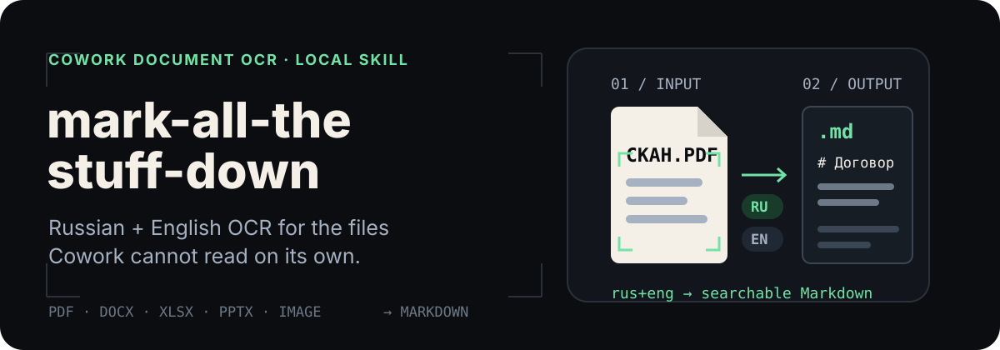

<p align="right">
  <strong>English</strong> · <a href="./README.ru.md">Русский</a>
</p>

<p align="center">
  
</p>

<p align="center">
  <strong>Give Cowork readable text—not another opaque attachment.</strong>
</p>

<p align="center">
  <a href="#install">Install</a> ·
  <a href="#use-it">Use it</a> ·
  <a href="#supported-formats">Formats</a> ·
  <a href="#errors-and-limits">Limits</a>
</p>

## OCR for the environment Cowork actually runs

Claude Cowork works inside a disposable virtual machine. That environment may
not retain MarkItDown dependencies or Russian Tesseract language data between
sessions. This skill fills that gap: it carries its own `rus+eng` tessdata,
detects PDFs without a usable text layer, and routes scans and images through
local OCR.

The result is a Markdown file beside the source document. Cowork can search it
or read it in small slices instead of loading a 200 KB contract into context at
once.

| Cowork receives | The skill does | Cowork gets |
| --- | --- | --- |
| Scanned PDF or image | Tesseract OCR with bundled `rus+eng` data | Searchable Markdown |
| PDF with a text layer | Extracts the existing text first | Clean Markdown without OCR noise |
| Office document | Uses MarkItDown or a format-specific local fallback | One consistent `.md` output |

No LLM is used for extraction. OCR and conversion run locally; network access
may still be needed during installation to fetch Python dependencies.

## See the result first

This repository's Russian test corpus includes contracts, memoranda,
spreadsheets, presentations, court documents, and ebooks. A PDF conversion
produces output like this:

```text
$ python convert.py "Меморандум.pdf"
/absolute/path/Меморандум.md (0.4 KB)
```

```markdown
Меморандум

Дата: 25 мая 2026 года

Тема: Анализ договора поставки
```

The generated file starts with a small provenance marker. Re-running the skill
on an unchanged source returns the cached Markdown instead of converting it
again.

## Install

### Claude Cowork / Claude.ai

1. Download the latest `mark-all-the-stuff-down-vX.Y.Z.skill` file from
   [Releases](https://github.com/strigov/mark-all-the-stuff-down/releases).
2. Open **Settings → Capabilities → Skills**.
3. Upload the `.skill` file.

This is the recommended path for Cowork: the release bundle already includes
the skill code and Russian, English, and orientation Tesseract data.

### Claude Code, Codex CLI, or pi.dev

macOS / Linux:

```sh
curl -LsSf https://raw.githubusercontent.com/strigov/mark-all-the-stuff-down/main/install.sh | sh
```

Windows PowerShell:

```powershell
irm https://raw.githubusercontent.com/strigov/mark-all-the-stuff-down/main/install.ps1 | iex
```

The installer prewarms document-conversion dependencies and links the skill
into any detected Claude, Codex, or pi skill directory. Use `--only=claude`,
`--only=codex`, or `--only=pi` on macOS/Linux when you want one target only.

### Runtime requirements

- Python 3.10 or newer.
- `tesseract` on `PATH` for image and scanned-PDF OCR.
- `pdftoppm` from Poppler for scanned-PDF OCR.
- Pillow for `.webp` OCR.

The `tesseract` executable and Poppler are system tools; the repository bundles
the `rus`, `eng`, and `osd` language data, not those executables.

## Use it

Once installed, the agent invokes the skill when a supported document or image
is attached or referenced. To run the converter directly:

```sh
python convert.py "/absolute/path/to/document.pdf"
```

Convert several files in parallel:

```sh
python convert.py --jobs 4 "contract.docx" "scan.pdf" "table.xlsx"
```

OCR-heavy files may exceed an agent shell's default timeout. Give the command at
least `300000` ms when the shell supports per-command timeouts. Otherwise,
process scans sequentially:

```sh
python convert.py --jobs 1 "scan-01.pdf" "scan-02.pdf"
```

Each successful conversion prints one line:

```text
<absolute-path-to-markdown> (<size>)
```

The agent should then use offset/limit reads or `grep` against that Markdown—not
paste the entire document into its context.

## Supported formats

| Documents | Images |
| --- | --- |
| DOCX, PDF, XLSX, XLS, PPTX, RTF, HTML, EPUB | PNG, JPG, JPEG, TIFF, TIF, BMP, WEBP |

The input limit is 50 MB per file. Legacy `.doc` files are intentionally not
supported; resave them as `.docx`.

## How it works

1. The skill validates the path, extension, protection status, and 50 MB limit.
2. Text-based documents use the best available local converter.
3. PDFs without usable text are rendered page by page with `pdftoppm`.
4. Scans and images go through Tesseract with bundled `rus+eng` data.
5. Markdown is written beside the source and tagged with source metadata for
   safe cache reuse.
6. The agent reads only the relevant sections.

## Errors and limits

Expected failures are explicit and safe to surface to the user:

| Message | Meaning / action |
| --- | --- |
| `WARN ocr-low-confidence` | OCR completed, but median confidence is below 60%. Review the Markdown. |
| `WARN xlsx-partial` | Charts or pivot tables could not be represented completely. |
| `ERROR ocr-failed` | `tesseract`, `pdftoppm`, or bundled tessdata is unavailable, or OCR failed. |
| `ERROR install-failed: webp requires Pillow` | Install Pillow or convert the image to another supported format. |
| `ERROR too-large` | The source exceeds 50 MB; split it before conversion. |
| `ERROR protected` | Provide an unprotected copy; the skill does not bypass protection. |
| `ERROR unsupported: .doc legacy` | Resave the file as `.docx`. |

## Configuration

| Variable | Effect |
| --- | --- |
| `MTSD_LOG=1` | Writes JSON metadata logs to `~/.cache/mtsd/log.jsonl` on macOS/Linux or `%LOCALAPPDATA%\mtsd\log.jsonl` on Windows. |
| `MTSD_LOG_VERBOSE=1` | Adds full source paths to logs; requires `MTSD_LOG=1`. |
| `MTSD_FORCE_PREINSTALLED=1` | Simulates a sandbox without uv or network access; intended for CI. |

## Development

```sh
python -m pip install -r requirements-dev.txt
python -m pytest
```

The test corpus covers Cyrillic filenames and content, text and scanned PDFs,
office formats, caching, install bundles, error handling, and offline fallback
paths.

## License

[AGPL-3.0](./LICENSE)
