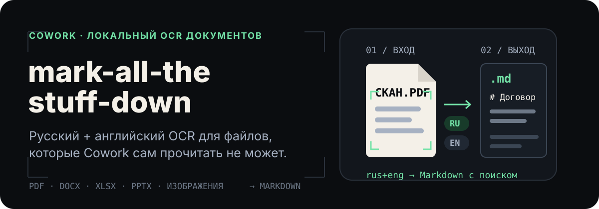

<p align="right">
  <a href="./README.md">English</a> · <strong>Русский</strong>
</p>

<p align="center">
  
</p>

<p align="center">
  <strong>Дайте Cowork читаемый текст, а не ещё одно непрозрачное вложение.</strong>
</p>

<p align="center">
  <a href="#установка">Установка</a> ·
  <a href="#использование">Использование</a> ·
  <a href="#поддерживаемые-форматы">Форматы</a> ·
  <a href="#ошибки-и-ограничения">Ограничения</a>
</p>

## OCR для реальной среды Cowork

Claude Cowork работает внутри одноразовой виртуальной машины. В ней между
сессиями могут не сохраняться зависимости MarkItDown и русские языковые данные
Tesseract. Этот скилл закрывает проблему: приносит с собой `rus+eng` tessdata,
распознаёт PDF без пригодного текстового слоя и направляет сканы и изображения
в локальный OCR.

Результат сохраняется в Markdown рядом с исходным документом. Cowork может
искать по нему или читать небольшими фрагментами, а не загружать договор на
200 КБ в контекст целиком.

| Что получает Cowork | Что делает скилл | Что получает Cowork в итоге |
| --- | --- | --- |
| Сканированный PDF или изображение | Tesseract OCR с комплектными данными `rus+eng` | Markdown с поиском по тексту |
| PDF с текстовым слоем | Сначала извлекает существующий текст | Чистый Markdown без шума OCR |
| Офисный документ | Использует MarkItDown или локальный fallback для формата | Единообразный файл `.md` |

Для извлечения текста LLM не используется. OCR и конвертация выполняются
локально; на этапе установки сеть может понадобиться для загрузки Python-
зависимостей.

## Сначала посмотрите на результат

Русский тестовый корпус репозитория содержит договоры, меморандумы, таблицы,
презентации, судебные документы и электронные книги. Конвертация PDF выглядит
так:

```text
$ python convert.py "Меморандум.pdf"
/абсолютный/путь/Меморандум.md (0.4 KB)
```

```markdown
Меморандум

Дата: 25 мая 2026 года

Тема: Анализ договора поставки
```

В начале созданного файла записывается компактный маркер происхождения.
Повторный запуск для неизменившегося источника возвращает закэшированный
Markdown и не выполняет конвертацию заново.

## Установка

### Claude Cowork / Claude.ai

1. Скачайте последний файл `mark-all-the-stuff-down-vX.Y.Z.skill` в разделе
   [Releases](https://github.com/strigov/mark-all-the-stuff-down/releases).
2. Откройте **Settings → Capabilities → Skills**.
3. Загрузите файл `.skill`.

Для Cowork это рекомендуемый способ: в release-бандле уже есть код скилла и
данные Tesseract для русского, английского и определения ориентации страницы.

### Claude Code, Codex CLI или pi.dev

macOS / Linux:

```sh
curl -LsSf https://raw.githubusercontent.com/strigov/mark-all-the-stuff-down/main/install.sh | sh
```

Windows PowerShell:

```powershell
irm https://raw.githubusercontent.com/strigov/mark-all-the-stuff-down/main/install.ps1 | iex
```

Установщик заранее подготавливает зависимости конвертера и подключает скилл ко
всем найденным каталогам Claude, Codex или pi. В macOS/Linux можно указать
только одну цель с помощью `--only=claude`, `--only=codex` или `--only=pi`.

### Требования среды

- Python 3.10 или новее.
- `tesseract` на `PATH` для OCR изображений и сканированных PDF.
- `pdftoppm` из Poppler для OCR сканированных PDF.
- Pillow для OCR файлов `.webp`.

Исполняемый файл `tesseract` и Poppler относятся к системным инструментам.
Репозиторий поставляет языковые данные `rus`, `eng` и `osd`, но не эти
исполняемые файлы.

## Использование

После установки агент вызывает скилл сам, когда получает поддерживаемый документ
или изображение. Ручной запуск конвертера:

```sh
python convert.py "/абсолютный/путь/к/документу.pdf"
```

Параллельная конвертация нескольких файлов:

```sh
python convert.py --jobs 4 "договор.docx" "скан.pdf" "таблица.xlsx"
```

OCR тяжёлых файлов может не уложиться в стандартный таймаут командного
инструмента агента. Если инструмент поддерживает отдельный таймаут команды,
задайте не менее `300000` мс. Иначе обрабатывайте сканы последовательно:

```sh
python convert.py --jobs 1 "скан-01.pdf" "скан-02.pdf"
```

Для каждого успешно обработанного файла скрипт печатает одну строку:

```text
<абсолютный-путь-к-markdown> (<размер>)
```

После этого агент должен читать Markdown через offset/limit или искать по нему
с помощью `grep`, а не вставлять весь документ в контекст.

## Поддерживаемые форматы

| Документы | Изображения |
| --- | --- |
| DOCX, PDF, XLSX, XLS, PPTX, RTF, HTML, EPUB | PNG, JPG, JPEG, TIFF, TIF, BMP, WEBP |

Лимит — 50 МБ на один входной файл. Устаревший формат `.doc` намеренно не
поддерживается: пересохраните такой файл в `.docx`.

## Как это работает

1. Скилл проверяет путь, расширение, наличие защиты и лимит 50 МБ.
2. Документы с текстом обрабатываются лучшим доступным локальным конвертером.
3. PDF без пригодного текста постранично рендерятся через `pdftoppm`.
4. Сканы и изображения проходят через Tesseract с комплектными данными
   `rus+eng`.
5. Markdown записывается рядом с источником и получает метаданные для безопасного
   повторного использования кэша.
6. Агент читает только нужные фрагменты.

## Ошибки и ограничения

Ожидаемые ошибки сформулированы явно, чтобы агент безопасно сообщил их
пользователю:

| Сообщение | Значение / действие |
| --- | --- |
| `WARN ocr-low-confidence` | OCR завершился, но медианная уверенность ниже 60%. Проверьте Markdown. |
| `WARN xlsx-partial` | Диаграммы или сводные таблицы не удалось представить полностью. |
| `ERROR ocr-failed` | Недоступен `tesseract`, `pdftoppm` или комплектный tessdata либо произошла ошибка OCR. |
| `ERROR install-failed: webp requires Pillow` | Установите Pillow или преобразуйте изображение в другой поддерживаемый формат. |
| `ERROR too-large` | Источник превышает 50 МБ; разделите его до конвертации. |
| `ERROR protected` | Предоставьте копию без защиты; скилл не обходит защиту. |
| `ERROR unsupported: .doc legacy` | Пересохраните файл в `.docx`. |

## Настройка

| Переменная | Эффект |
| --- | --- |
| `MTSD_LOG=1` | Записывает JSON-логи метаданных в `~/.cache/mtsd/log.jsonl` на macOS/Linux или `%LOCALAPPDATA%\mtsd\log.jsonl` на Windows. |
| `MTSD_LOG_VERBOSE=1` | Добавляет в логи полные пути; требует `MTSD_LOG=1`. |
| `MTSD_FORCE_PREINSTALLED=1` | Имитирует sandbox без uv и сети; предназначено для CI. |

## Разработка

```sh
python -m pip install -r requirements-dev.txt
python -m pytest
```

Тестовый корпус проверяет кириллические имена и содержимое файлов, PDF с текстом
и сканами, офисные форматы, кэширование, установочные бандлы, обработку ошибок и
fallback-пути без сети.

## Лицензия

[AGPL-3.0](./LICENSE)
